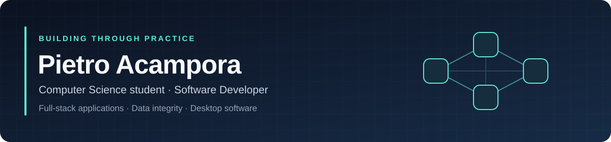

I turn university foundations and practical problems into applications I can understand, test and improve.

**University of Padua · Udine / Padua, Italy**

Open to **internships and junior roles**, including remote work and relocation.

## A little about me

I'm a Computer Science student interested in the whole journey from a data model to a usable application. My projects span business tools, electric mobility, data validation and desktop software.

I care about clear responsibilities, reliable data and understanding why the code works. I learn by building features step by step, documenting decisions and improving the structure as the project grows.

## Selected work

### ⚡ [EcoFleet Solutions](https://github.com/hipietro/ecofleet-solutions-db)

**From a university database project to a full-stack electric mobility application.**

`React` · `TypeScript` · `Python` · `FastAPI` · `PostgreSQL` · `psycopg`

- Relational modelling, constraints, triggers and stored functions form the foundation.
- The backend handles authentication, rental workflows and vehicle-specific pricing with corporate discounts.
- The React frontend currently includes login, rental history, available vehicles, brand filtering and vehicle details.
- **In active development:** a practical setting for learning how frontend, API and database decisions fit together.

### 🌿 [GreenWork Manager](https://github.com/hipietro/greenwork_manager)

**A working management application for small gardening businesses.**

`React` · `TypeScript` · `Node.js` · `Express` · `PostgreSQL` · `Prisma`

- Organizes jobs, employees, equipment and daily attendance.
- Uses JWT authentication and server-enforced permissions, including a read-only demo account.
- Deployed on Render with Neon PostgreSQL.

**[Explore the live demo →](https://greenwork-manager-pietro.onrender.com)**

### ✅ [Order Integrity Checker](https://github.com/hipietro/order_integrity_checker)

**A Python application that checks business orders before they enter the database.**

`Python` · `SQLite` · `FastAPI` · `Tkinter` · `GitHub Actions`

- Normalizes CSV records, validates fields and detects exact or suspicious duplicates.
- Imports batches atomically and maintains transactional audit history.
- Shares application services across CLI, desktop GUI and REST API, with automated tests and CI.
- **Feature-complete:** maintained as a portfolio project and reference implementation.

### 📅 [Qt Agenda](https://github.com/hipietro/qt_agenda)

**A desktop organizer built around object-oriented design.**

`C++17` · `Qt 6` · `JSON` · `Automated testing`

- Models events, deadlines, reminders and checklists through polymorphism.
- Supports recurring activities, search, filtering, persistence and undo/redo.
- Separates domain logic, interface, persistence and commands.

## Tools I use in my projects

| Area | Technologies |
| --- | --- |
| Frontend | React, TypeScript, JavaScript |
| Backend | Python, FastAPI, Node.js, Express |
| Data | PostgreSQL, SQLite, SQL, psycopg, Prisma |
| Desktop & foundations | C++, Qt, C |
| Development workflow | Git, GitHub Actions, automated testing |

## What I'm learning next

I'm using EcoFleet to strengthen **React and Python**, while building toward a broader understanding of data processing and application delivery.

| Focus | Learning direction |
| --- | --- |
| Application development | React state, effects, routing and API integration; Python backend design |
| Data processing | NumPy and pandas |
| Containers & deployment | Docker, followed by Kubernetes |
| Longer-term direction | Azure and AI engineering; studying toward AI-200 |

These are learning goals, developed through practical work as each project needs them.

## Certifications & languages

- **[Programming for Everybody — University of Michigan / Coursera](https://www.coursera.org/account/accomplishments/verify/2UGUOZ0P5092)**
- **Cisco CCNA**
- **Cambridge English B2** · Native Italian

---

**Have a role or a project where I could contribute and keep learning?**

[Let's connect on LinkedIn](https://www.linkedin.com/in/pietro-acampora-79b146338/) · [Send me an email](mailto:pietrolacampora@gmail.com)

